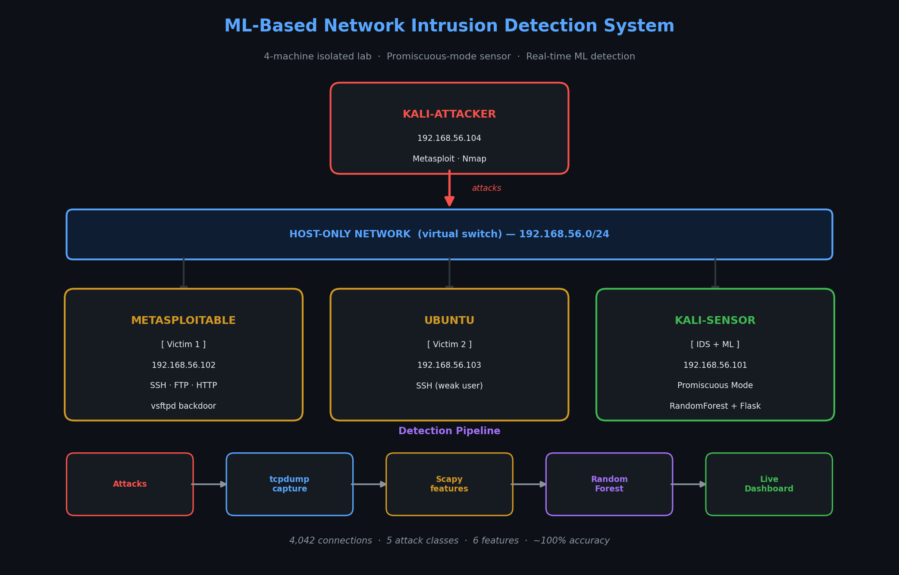

# 🛡️ ML-Based Network Intrusion Detection System (NIDS)

A machine-learning intrusion detection system that monitors an entire virtual network and detects attacks in **real time**. Built from scratch: the lab, the attacks, the dataset, the ML model, and a live web dashboard.

> **TL;DR** — I built a 4-machine virtual enterprise network (attacker + 2 victims + a central IDS sensor), generated real attack traffic by actually running the attacks, extracted features from the captured traffic, trained a Random Forest classifier, and deployed it as a real-time detector with a Flask dashboard.

---

## 🎯 Overview

Most IDS tutorials use a pre-made dataset downloaded from the internet. This project is different: **the dataset was generated by me**, by running real attacks inside an isolated lab and capturing the traffic. This means the full pipeline — network → attacks → capture → features → model → live detection — was built and understood end to end.

The IDS sensor uses **promiscuous mode** to monitor traffic across the whole network, so it detects attacks against *any* victim, not just itself — exactly how a real Network-based IDS (NIDS) works.

---

## 🏗️ Architecture



| Machine | IP | Role |
|---------|-----|------|
| Kali-Attacker | .104 | Launches attacks |
| Metasploitable 2 | .102 | Vulnerable victim |
| Ubuntu | .103 | Second victim |
| Kali-Sensor | .101 | **IDS + ML + Dashboard** |

---

## 🔬 How It Works

### 1. Attack Generation (Pentesting)
Real attacks launched from the attacker machine against both victims:
- **Port scanning** (Nmap)
- **SSH brute force** (Metasploit `ssh_login`)
- **Exploit** (vsftpd 2.3.4 backdoor)
- **Web attacks** (SQL injection / XSS on DVWA)

### 2. Traffic Capture
The sensor captures **all** network traffic in promiscuous mode (`tcpdump`), producing ~12 MB of raw traffic (41,000+ packets).

### 3. Feature Extraction
Each connection (flow) is split into windows, and 6 numeric features are extracted:

| Feature | Description |
|---------|-------------|
| `nb_packets` | Number of packets |
| `total_bytes` | Total bytes |
| `dport` | Destination port |
| `duration` | Flow duration |
| `avg_size` | Average packet size |
| `direction` | **Inbound (to victim) vs outbound** |

> The `direction` feature was added after realizing the model should focus on traffic *reaching* the victim (attacks), not traffic leaving it.

### 4. Machine Learning
- **Random Forest** classifier (`scikit-learn`)
- `class_weight='balanced'` to handle class imbalance
- **4,042 connections**, 5 attack classes
- Train/test split with stratification

### 5. Real-Time Detection + Dashboard
The trained model runs live on network traffic. A **Flask web dashboard** shows alerts in real time, with statistics and a color-coded table (victim name, port, attack type).

---

## 📊 Results

| Metric | Value |
|--------|-------|
| Dataset size | 4,042 connections |
| Attack classes | 5 (bruteforce, portscan, exploit, web, normal) |
| Accuracy | ~100% (on a large, balanced test set) |
| Top features | `duration`, `dport`, `direction` |

The model correctly classifies all 5 traffic types on the test set. The `direction` feature ranked among the top 3 most important features, confirming its value.

---

## 🛠️ Tech Stack

- **Virtualization:** VirtualBox (4 VMs)
- **Attack tools:** Metasploit, Nmap
- **Capture:** tcpdump, Scapy
- **ML:** scikit-learn (Random Forest), pandas
- **Dashboard:** Flask
- **OS:** Kali Linux, Metasploitable 2, Ubuntu

---

## 📁 Project Structure

---

## 🚀 Usage

```bash
# 1. Generate attacks (from attacker machine)
./attack_network.sh

# 2. Extract features from captured traffic
python extract_v2.py

# 3. Train the model
python train_v2.py

# 4. Run real-time detection + dashboard (on sensor)
sudo venv/bin/python detect_dashboard.py
# Open http://127.0.0.1:5000
```

---

## ⚠️ Ethics & Legal

This project runs **entirely inside an isolated lab** (Host-Only network, no internet access to the targets). All attacks target machines I own, built specifically for security training (Metasploitable, DVWA).

**Never run these techniques against systems you don't own or lack explicit permission to test.** This project focuses on the **defensive** side — detection — not on providing ready-to-use exploits.

---

## 📈 Possible Improvements

- Compare models (XGBoost, Neural Networks)
- Add more attack types (DoS, FTP brute force, Samba exploit)
- Deploy the sensor on a dedicated VM
- Add packet-level deep inspection
- Alerting (email / Slack) on detection

---

## 👤 Author

Built as a hands-on learning project combining **penetration testing** and **machine learning** for network security.

*If you found this useful, feel free to star ⭐ the repo.*
